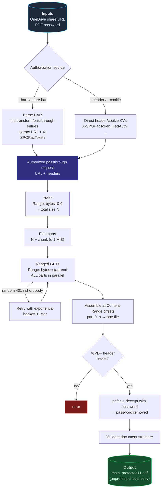

# OneDrive Protected PDF Extractor - `odpdf`

A small Go CLI that downloads a **password-protected PDF** shared through a
OneDrive "protected" link, reassembles the streamed octet-stream parts into
the complete file, and **removes the PDF password locally**.

> **Scope:** `odpdf` performs only the ordinary download requests that the
> OneDrive web viewer itself performs. It does not circumvent access control:
> you need a working share link and its authorization (from your own HAR
> capture or session headers), and the PDF password is an input, not something
> that is cracked.

## How it works

The OneDrive PDF viewer does not fetch the document in one piece: while you
scroll, it requests **byte ranges** from the MediaTA
`transform/passthrough` endpoint and stitches the octet-stream parts
together. Two quirks of that endpoint shape this tool:

- A request **without** a `Range` header returns a *malformed* body: real PDF
  bytes for roughly the first megabyte, then zero padding to the declared
  length. Only ranged requests deliver true slices.
- Ranged requests fail **intermittently** with `401` (the passthrough
  service's upstream fetch flaps); a few retries with backoff converge.



## Install

```sh
go build -o odpdf ./cmd/odpdf
```

Requires Go 1.21+ (tested with Go 1.27). No external services besides the
OneDrive endpoints themselves.

## Usage

```sh
odpdf [flags] <onedrive-url>
```

The URL may be the share link exactly as opened in the browser, or a direct
`transform/passthrough` URL.

### With a HAR capture (recommended)

Export the PDF viewer session from your browser's devtools (Network tab →
"Save All As HAR"). `odpdf` extracts the authorized passthrough request from
it — the response bodies in the HAR are ignored (they are truncated capture
artifacts), only the request URL and headers are used.

```sh
odpdf -H capture.har -p 'the-pdf-password' \
  'https://XXX.sharepoint.com/personal/.../onedrive.aspx?id=...&share=...'
```

### With direct header/cookie key-values

Instead of a HAR you can pass the same headers the viewer sends:

```sh
odpdf \
  --header 'X-SPOPacToken: v1.eyJ...' \
  --cookie 'FedAuth=...; rtFa=...' \
  -p 'the-pdf-password' \
  'https://XXX.sharepoint.com/personal/.../onedrive.aspx?id=...&share=...'
```

Accepted KV forms: `"Name: Value"` or `"Name=Value"`; cookies as `"a=b; c=d"`
or `"Cookie: a=b"`. When no HAR is present the share URL is resolved through
the SharePoint `shares` API first (this needs cookies that authenticate
`_api/v2.0`); passing a direct `transform/passthrough` URL skips resolution.

### Password

`-p/--password`, else `$ODPDF_PASSWORD` / `$PDF_PASSWORD`, else prompted
(interactively, without echo).

## Flags

| Flag | Default | Meaning |
|---|---|---|
| `-H, --har FILE` | – | HAR capture to extract the authorized request from (repeatable) |
| `--header "N: V"` | – | direct header KV (repeatable) |
| `--cookie "k=v"` | – | direct cookie KV (repeatable) |
| `-p, --password PASS` | prompt | PDF password |
| `--chunk N` | `524288` | bytes per range request (max 1 MiB — larger gets zero-padded by the service) |
| `-c, --concurrency N` | `0` | parallel range requests; `0` = **all parts at once** |
| `--retries N` | `8` | max attempts per part (flaky 401s are normal) |
| `--timeout D` | `2m` | per-request timeout |
| `-o, --out FILE` | `<name>.pdf` | decrypted PDF output path |
| `--raw-out FILE` | `<name>.encrypted.pdf` | keep the raw encrypted download here |
| `--keep-raw` | `true` | keep the raw encrypted PDF |
| `--mediap-host HOST` | `westeurope1-mediap.svc.ms` | passthrough host for no-HAR URL resolution |
| `--color MODE` | `auto` | `auto\|always\|never` (honors `NO_COLOR` and `TERM=dumb`) |
| `-q, --quiet` | `false` | suppress progress output |

## Output

Given `id=.../main_protected11.pdf` the default result is:

- `main_protected11.encrypted.pdf` — the raw assembled download (still
  password-protected); removed with `--keep-raw=false`
- `main_protected11.pdf` — the decrypted, validated local copy

The decrypted path is also printed on stdout as the last line, for scripting.

## Notes

- The `X-SPOPacToken` in a HAR capture expires (typically within hours).
  Re-capture if downloads start failing with persistent 401s after retries.
- Parts are placed at the `Content-Range` offsets the service reports, so
  out-of-order completion and partial retries cannot corrupt the assembly.
- Ctrl-C cancels cleanly.
